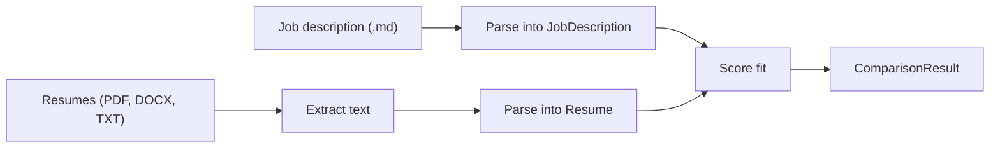

# Resume–Job Matcher

A small Python pipeline that reads a job description and a directory of resumes, turns
both into structured records, and scores each candidate against the role.

It is built to show how an LLM feature stays reliable when the model is forced to return
a schema, and how that work can run across several files without one slow resume blocking
the rest.

Given the sample Amazon SDE-I description and the resumes in `samples/resumes/`, a run
prints one result per file: a 0–100 score, a verdict, strengths, weaknesses, and the
reasoning behind the decision.

## What this demonstrates

- **Structured extraction.** Job descriptions and resumes are parsed into
  [Pydantic](https://docs.pydantic.dev/) models. The JSON Schema is part of the prompt,
  Groq is called in JSON mode, and the response is validated before it is used.
- **A two-stage comparison.** The scorer compares structured resume data with a structured
  job description, so the model is not re-reading raw PDF text at scoring time.
- **Bounded parallelism.** Resumes are processed with a process pool capped at two workers,
  which keeps the batch moving while staying inside a tight API token budget.
- **Format handling.** Text is pulled from PDF, DOCX, and plain-text files before any model
  call.

## How it works



1. `samples/job_description.md` is parsed into a `JobDescription`: role, required and
   preferred skills, minimum experience, education, and responsibilities. This call
   uses `openai/gpt-oss-20b`.
2. Each file in `samples/resumes/` is read locally. PDF text comes from `pypdf`; DOCX
   text comes from `python-docx`.
3. The extracted text is parsed into a `Resume`: contact fields, skills, certifications,
   education, experience (including internships), and projects. Missing lists become empty
   lists. Missing scalars become `null`. The model is instructed not to invent facts.
   This call uses `openai/gpt-oss-120b`.
4. The structured resume and job description are compared. The model returns a
   `ComparisonResult`: candidate name, overall score, verdict, strengths, weaknesses, and
   decision reasoning. Verdicts are `Strong Match`, `Good Match`, `Neutral`, `Poor Match`,
   and `Strongly Poor Match`.
5. Results print as each resume finishes. Order follows completion, not filename order.

Worker failures are re-raised as `RuntimeError`. Groq’s own exception type cannot be pickled
back to the parent process, so the original message is preserved as a plain string.

## Project layout

```
llm-resume-job-matcher/
├── main.py                         # Batch entry point
├── llm/client.py                   # Groq client, JSON mode
├── schemas/
│   ├── job_description.py
│   └── resume/                     # Resume, education, experience, project, score
├── utils/
│   ├── extract_content.py          # PDF, DOCX, and TXT readers
│   ├── parse_job_description.py
│   ├── parse_resume.py
│   └── evaluate_resume.py
├── samples/
│   ├── job_description.md          # Amazon SDE-I posting
│   └── resumes/                    # Demo resumes
├── requirements.txt
└── .env.example
```

## Setup

Requires Python 3.11 or newer and a [Groq API key](https://console.groq.com/keys).

```bash
python3 -m venv .venv
source .venv/bin/activate
pip install -r requirements.txt
cp .env.example .env
```

Put the key in `.env`:

```
GROQ_API_KEY=gsk_...
```

`.env` is gitignored. Only `.env.example` is committed.

Run the sample batch from the repository root:

```bash
python main.py
```

A successful line looks like this. Scores vary between runs because the judge is a
generative model.

```text
candidate_name='Alex Rivera' overall_score=72.0 verdict=<Verdict.GOOD_MATCH: 'Good Match'> strengths=[...] weaknesses=[...] decision_reasoning='...'
```

Replace `samples/job_description.md` or drop your own PDF and DOCX files into
`samples/resumes/` to try another role. Paths are fixed in `main.py`; there is no
CLI yet.

## Design notes

The contract lives in the Pydantic models, not in free-form prompt prose.
`model_json_schema()` is interpolated into the system prompt, `response_format` is
`json_object`, and `model_validate_json` rejects a response that does not match. A
bad completion fails the file instead of flowing into the score as a half-parsed dict.

Scoring sees the parsed models, not the original PDF. That keeps the comparison about
skills, experience, and responsibilities, and it makes the extracted record inspectable
if a score looks wrong.

The job-description parse uses the smaller default model (`openai/gpt-oss-20b`). Resume
parsing and scoring use `openai/gpt-oss-120b`, where headings vary and the judgment
needs more context.

## Limits

- The score is a model judgment. It is not calibrated against hiring outcomes, and the
  same resume can move a few points between runs.
- There is no retry or backoff. A token-limit error fails that resume for the run.
- `.doc` is accepted by file extension, but `python-docx` reads Office Open XML (`.docx`).
  Legacy `.doc` files should be resaved as `.docx` or PDF.
- Scanned PDFs with no text layer extract as empty text. This project does not run OCR.
